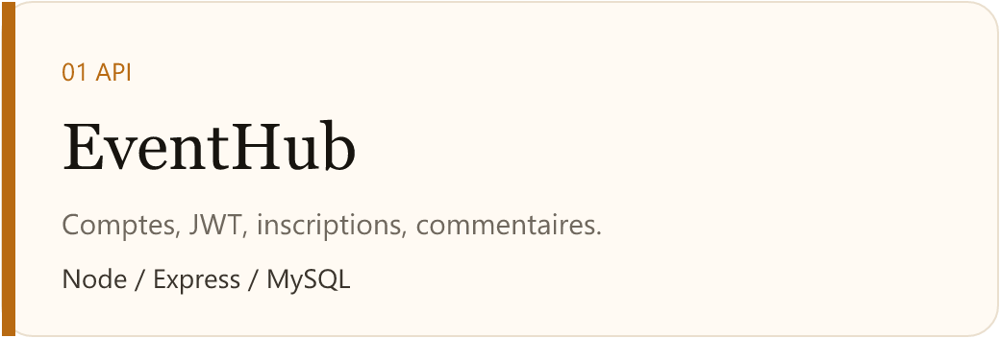
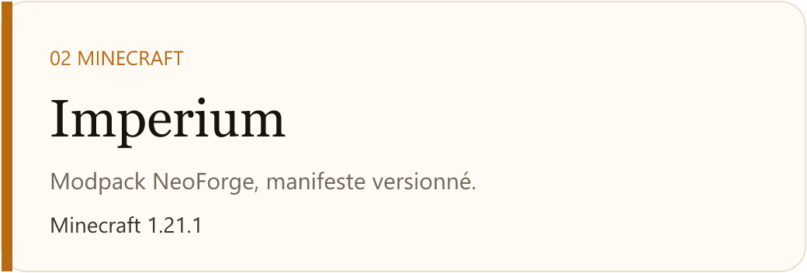
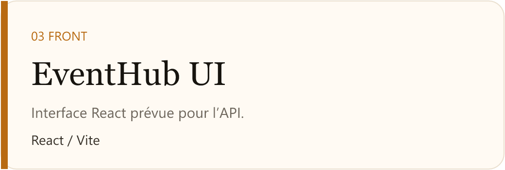
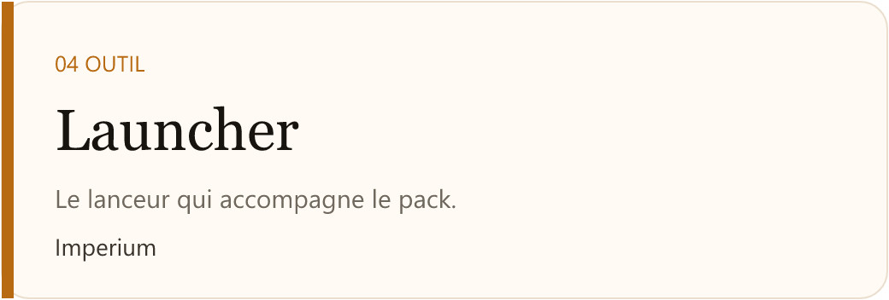
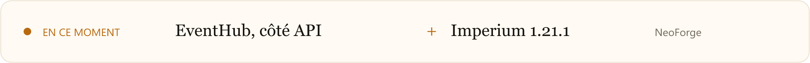

  <picture>
    <source media="(prefers-color-scheme: dark)" srcset="./banner-dark.png">
    
  </picture>

  

  Je construis des interfaces et des APIs pendant ma formation, et un modpack Minecraft que je package moi-même.

  <picture>
    <source media="(prefers-color-scheme: dark)" srcset="https://skillicons.dev/icons?i=html,css,js,react,vite,nodejs,express,mysql,git&perline=9&theme=dark">
    
  </picture>

## Projets

  <a href="https://github.com/OtaaRL/BDD-EXO">
    <picture>
      <source media="(prefers-color-scheme: dark)" srcset="./card-eventhub-dark.png">
      
    </picture>
  </a>
  &nbsp;&nbsp;
  <a href="https://github.com/OtaaRL/Imperium-pack">
    <picture>
      <source media="(prefers-color-scheme: dark)" srcset="./card-imperium-dark.png">
      
    </picture>
  </a>

  <a href="https://github.com/OtaaRL/events_front">
    <picture>
      <source media="(prefers-color-scheme: dark)" srcset="./card-front-dark.png">
      
    </picture>
  </a>
  &nbsp;&nbsp;
  <a href="https://github.com/OtaaRL/launcher-imperium">
    <picture>
      <source media="(prefers-color-scheme: dark)" srcset="./card-launcher-dark.png">
      
    </picture>
  </a>

  <a href="https://github.com/OtaaRL/Projet-Soundboard">Soundboard</a>
  &nbsp;·&nbsp;
  <a href="https://github.com/OtaaRL/site-forma">Récap de cours</a>

  <picture>
    <source media="(prefers-color-scheme: dark)" srcset="./now-dark.png">
    
  </picture>

## Activité

  <picture>
    <source media="(prefers-color-scheme: dark)" srcset="https://github-readme-stats.vercel.app/api?username=OtaaRL&show_icons=true&hide_border=true&hide=issues&bg_color=101114&title_color=f4efe6&text_color=d9d3c8&icon_color=e39b3a&border_radius=16">
    
  </picture>
  &nbsp;
  <picture>
    <source media="(prefers-color-scheme: dark)" srcset="https://github-readme-stats.vercel.app/api/top-langs/?username=OtaaRL&layout=compact&hide_border=true&bg_color=101114&title_color=f4efe6&text_color=d9d3c8&border_radius=16">
    
  </picture>

  <picture>
    <source media="(prefers-color-scheme: dark)" srcset="https://raw.githubusercontent.com/OtaaRL/OtaaRL/output/github-contribution-grid-snake-dark.svg">
    
  </picture>

