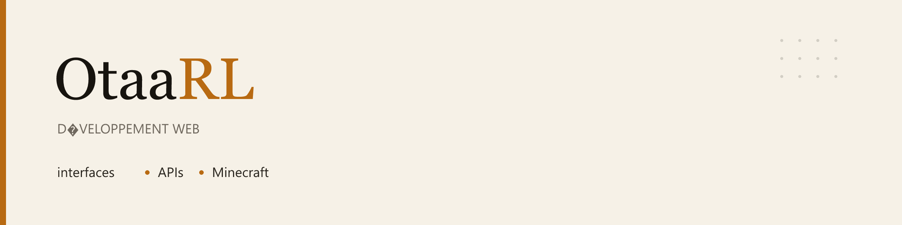

<picture>
  <source media="(prefers-color-scheme: dark)" srcset="./banner-dark.png">
  
</picture>

 

Je suis en formation développement web. Je fais des interfaces, des APIs, et à côté un modpack Minecraft que je package moi-même.

  
  
  
  
  
  

## Projets

| | |
| --- | --- |
| **[EventHub](https://github.com/OtaaRL/BDD-EXO)** | API REST pour des événements collaboratifs : comptes, JWT, inscriptions, commentaires. Node.js, Express, MySQL. |
| **[events_front](https://github.com/OtaaRL/events_front)** | Front React / Vite prévu pour EventHub. |
| **[Imperium](https://github.com/OtaaRL/Imperium-pack)** | Modpack Minecraft 1.21.1 sur NeoForge, versionné avec son manifeste. |
| **[Launcher Imperium](https://github.com/OtaaRL/launcher-imperium)** | Launcher qui va avec le pack. |
| **[Soundboard](https://github.com/OtaaRL/Projet-Soundboard)** | Petit projet son, repris d’un exercice. |
| **[Récap de cours](https://github.com/OtaaRL/site-forma)** | Notes de formation, en HTML. |

## En ce moment

EventHub côté API, et le pack Imperium (mods, manifeste, launcher).
